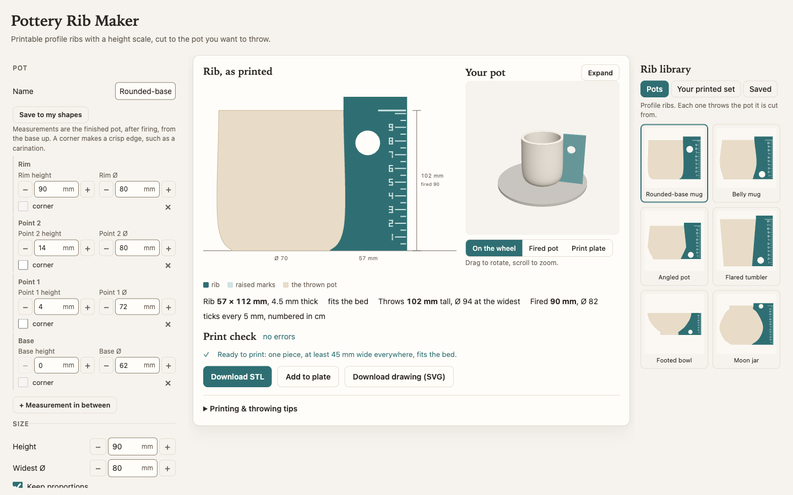

# Pottery Rib Maker

Design profile ribs for the potter's wheel, and 3D print them. You describe the mug, pot, or bowl that you want to throw. The app cuts a rib whose edge is that pot's outside wall, and it puts a height scale on the rib. The app gives you an STL file to print.



- **The rib throws the pot you drew.** The working edge follows the pot's wall from the base to the rim. Hold the rib to the clay while the wheel turns, and the wall takes that shape.
- **The rib can have a height scale.** Ticks run up the back edge in cm, mm, or inches and count the wet height. The scale can also work as a conversion chart. A sloped line runs from each wet height down to the dry and fired heights it shrinks to, and each number sits at the height it names. A long line marks the rim, and you can add lines at any height, such as where a handle goes.
- **The rib shows what shrinkage does.** You draw the pot at the size you throw it. Your clay's shrinkage sets the dry and fired numbers on the scale, and the drawing outlines the bone-dry and fired pot inside the thrown one.
- **You see the pot before you print.** A 3D view shows the rib against the thrown pot on the wheel, and the fired pot alone. The print plate view shows the STL file on the bed of your printer.

## Run it

You need [Node.js](https://nodejs.org) 22 or later.

```sh
git clone https://github.com/aasimsani/pottery-rib-maker.git
cd pottery-rib-maker
npm install
npm run dev
```

Then open http://localhost:5173. Everything runs in your browser, and your browser also saves your shapes.

To host the app yourself, run `npm run build` and put the `dist/` folder on any static host.

To host the app on Cloudflare Workers, run `npx wrangler login` once. Then run `npm run deploy`, which builds the app and publishes it. The file `wrangler.jsonc` configures Cloudflare to serve the build as static assets at `aasimsani.net/projects/pottery-rib-maker`. If you deploy a fork, replace `account_id` and `routes` in that file with your own.

The workflow `.github/workflows/ci.yml` runs the tests and the build on every pull request. The workflow `.github/workflows/deploy.yml` deploys every push to `main` after the tests and the build pass. You can also start it from the **Actions** tab. It needs a Cloudflare API token from the **Edit Cloudflare Workers** template, saved as the repository secret `CLOUDFLARE_API_TOKEN`.

## Make a rib

1. **Pick a shape, or start from a photo.** Click a shape in the **Rib library**, or click **From a photo** to trace a pot from a shop photo, a museum page, or your phone. The photo guide shows which photos trace well, and you can try a good and a bad example first. Then drop, paste, or load the photo, and enter the height you'll throw it to. The trace keeps the pot's proportions and marks sharp bends as corners. **Pots** holds profile ribs for mugs, pots, and bowls. **Your printed set** holds the five ribs of the [Ceramic Rib Tool Set](https://makerworld.com/en/models/1963257-ceramic-rib-tool-set) on MakerWorld.
2. **Draw the pot.** Drag the points on the rib drawing to reshape the pot's wall. To add a point, drag a **＋** between two points, or double-click anywhere on the drawing. Select a point to make it a **corner**, which gives a crisp edge such as the carination of an angled pot, or to delete it. **Start over** gives you a plain cylinder at the same size, and **Undo** (⌘Z or Ctrl+Z) steps back. To type exact numbers, use the table under **Pot**. The numbers are the height and the outside Ø of the pot as you throw it, wet.
   - The arrow keys move the selected point by the snap step, and Shift moves it 5 mm. Delete removes it, and C makes it a corner.
   - The **Drawing limits** stop shapes that cannot work. Each point stays at least 2 mm above the point below it, and no point gets narrower than Ø 20 mm. A point also stops where the wall would fold back on itself, because the rib could not pull away from that wall. You can change the limits and the 0.5 mm snap step.
3. **Set the size.** **Height** and **Widest Ø** resize the whole pot. With **Keep proportions** on, the two change together. Enter your clay's **shrinkage**. Most stoneware shrinks 10–14% from wet to fired. Shrinkage does not change the rib. It sets the dry and fired numbers and the **Fired pot** view.
4. **Shape the rib.** **Narrowest width** sets how much plastic is behind the working edge. **Above the rim** makes the rib taller than the pot, so the rim line sits on the rib. **Both long edges throw the pot** makes the back edge a second working edge.
5. **Set the height scale.** Clear **Put a height scale on the rib** for a plain rib. Otherwise, pick the units and the numbers. With **wet and fired**, a sloped line runs from each wet height down to its fired height, so a pot thrown to the 9 cm line reads 7.9 at 7.9 cm. **Wet, dry, and fired** adds a bone-dry column between them, which needs a rib about 75 mm wide. Enter your clay's **Drying shrinkage**, which is part of the total shrinkage. To add lines, enter wet heights in mm in **More marks at**. The rim line and each extra line carry their own wet, dry, and fired numbers.
6. **Check the rib.** Fix every error that the **Print check** marks.
7. **Download the 3MF or STL file**, and then slice it. The rib and its marks are separate parts, so you can print the marks in a second filament. Bambu Studio opens the 3MF as one object with two parts, **Rib** and **Scale marks**. The STL download is two files, one for the rib and one for the marks. Select both when you import them, and Bambu Studio loads them as one object. For a single merged STL, clear **Save the marks as a separate part** under **Height scale**. To print several ribs together, click **Add to plate** for each one. Then click **Download plate (.3mf)**, which saves one file with every rib placed on the bed.

## Print it

The defaults suit a Bambu Lab P2S with a 0.4 mm nozzle. To use a different bed size, change it under **Printer settings**.

- Print the rib flat, with the marks facing up, exactly as exported. Turn the brim off.
- Use PETG, because it survives water and clay grit better than PLA. The print project for the Ceramic Rib Tool Set uses PETG at 0.12 mm layers, with 4 walls and 40% gyroid infill.
- To print the marks in a second color, save them as a separate part and give that part its own filament. On a printer with one filament, add a filament change at the layer where the marks start.
- Rub the working edge with 400-grit wet sandpaper, so it leaves a smooth wall.

## Use it

Stand the rib on the wheel head or the bat, so the scale counts up from where the pot sits. Throw the wall a little taller than the rim line. Then hold the working edge to the clay from the base up while the wheel turns slowly, and trim the rim level with the line.

## How it works

The app samples a centripetal Catmull-Rom curve through the measurements. Points marked as corners split the curve into separate runs. The curve becomes the rib's working edge, and the app extrudes the outline with three.js. The marks are boxes that sink 0.2 mm into the top face, so the slicer joins them to the rib. The tests check these facts for every shape in the library:

- The rib is a closed solid.
- The working edge matches the pot.
- Every mark sits on the rib and clear of the finger hole.

## License

MIT
